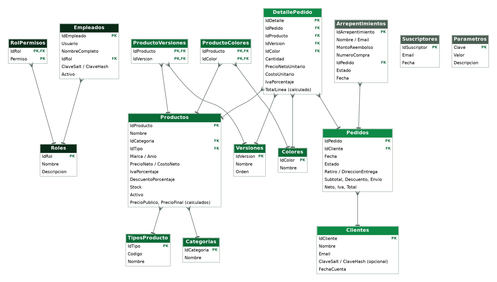

# 1. Introducción

Electro Banfield es una tienda online de electrónica (smartphones, notebooks, tablets, audio, smartwatches, TV y monitores, gaming y accesorios, con 38 productos de marcas como Samsung, Apple, Sony, LG, Logitech y JBL). Tiene dos partes:

- **La tienda** que ve el cliente: catálogo con menú de categorías, buscador, filtros, carrito y confirmación de pedido. **Para comprar no hace falta crear una cuenta**; la cuenta es opcional y sirve para ver el historial de pedidos.
- **El panel de empleados**, al que se entra con "Iniciar sesión". Según el rol de cada usuario se pueden ver informes de ventas, cambiar el estado de los pedidos, agregar stock, modificar precios, dar de alta y de baja productos, gestionar empleados y, solo para el dueño, ver las ganancias.

Los datos (productos, pedidos, clientes, empleados) se guardan en **SQL Server**. Un servidor **Node.js** hace de intermediario entre la página y la base de datos.

## 1.1 Requisitos funcionales

| Requisito | Qué se implementó |
|---|---|
| A. Autenticación y módulos de empleados | Inicio de sesión, ABM de empleados y gestión de roles (dueño, gerente, administrativo, cajero, repositor) con permisos por rol. |
| B. ABM de productos y catálogo | Alta, edición y baja de productos con imagen, nombre y descripción, precio neto, IVA, precio al público, descuentos y control de stock. |
| C. Tienda | Catálogo dinámico, buscador y filtros, carrito y proceso de confirmación de pedido. |
| D. Reportes y listados de ventas | Listado general de ventas (por fechas y producto) y facturación diaria, semanal, mensual y anual. |

Además: estados de pedido, favoritos, cuentas opcionales de clientes, botón de arrepentimiento, newsletter y una sección de ganancias para el dueño.

# 2. Arquitectura

```
  Navegador (HTML + JavaScript)
          │  HTTPS + JSON
          ▼
  Servidor Node.js  ── valida datos, controla sesión y permisos
          │  consultas con parámetros / procedimientos almacenados
          ▼
  SQL Server (base EcommerceBanfield)
```

- **Página (`public/index.html`)**: una sola página que dibuja la tienda y el panel. No guarda datos de negocio en el navegador (solo la lista de favoritos y la sesión).
- **Servidor (`server/`)**: `index.js` (HTTP, archivos estáticos, autenticación), `routes.js` (API), `auth.js` (tokens firmados y límite de intentos) y `db.js` (conexión a SQL Server).
- **Base de datos (`sql/01_base_de_datos.sql`)**: tablas, restricciones, vistas de reportes y procedimientos almacenados con la lógica del negocio.

**Tecnologías:** HTML, CSS y JavaScript sin frameworks; Node.js 18 o superior con el paquete `mssql`; SQL Server 2017 o superior.

# 3. Modelo de datos

{width=100%}

Las tablas se agrupan así:

| Grupo | Tablas |
|---|---|
| Empleados y permisos | `Roles`, `RolPermisos`, `Empleados` |
| Catálogo | `Categorias`, `TiposProducto`, `Productos`, `Versiones`, `Colores`, `ProductoVersiones`, `ProductoColores` |
| Ventas | `Clientes`, `Pedidos`, `DetallePedido` |
| Otras | `Suscriptores`, `Arrepentimientos`, `Parametros` |

## 3.1 Decisiones de diseño

- **Precios.** `Productos` guarda el precio neto (sin IVA), el IVA y el descuento. El precio al público y el precio final son columnas calculadas, por lo que siempre son coherentes.
- **Historial de precios.** `DetallePedido` guarda el precio neto y el costo **al momento de la compra**. Si después cambia el precio, las ventas anteriores no se alteran.
- **Baja de productos.** Un producto no se borra: se marca `Activo = 0`. Así se conserva el historial de ventas.
- **Versiones y colores.** Cada producto puede tener versiones (capacidad, pulgadas) y colores. Si las tiene, el cliente debe elegir una al comprar. El catálogo actual no usa versiones ni colores, pero el sistema los soporta y se cargan desde el panel.
- **Clientes con o sin cuenta.** Todo pedido queda asociado a un cliente identificado por email. Si el cliente nunca creó una cuenta, `ClaveHash` queda en `NULL`. Si después crea una cuenta con el mismo email, conserva sus pedidos anteriores.
- **Contraseñas.** Nunca se guardan en texto plano: se guarda `SHA2_256(sal + contraseña)` con una sal aleatoria por usuario.
- **Parámetros del negocio.** El IVA, el monto de envío gratis, el costo de envío y el umbral de stock bajo están en la tabla `Parametros`, no en el código.

## 3.2 Restricciones principales

- Precios y stock nunca negativos; descuento de 0 a 100; cantidad mayor a 0.
- Estado de pedido solo `pendiente`, `pagado`, `enviado`, `entregado` o `cancelado`.
- Si el pedido es a domicilio, la dirección es obligatoria.
- Email único por cliente; usuario único por empleado.

## 3.3 Vistas para reportes

| Vista | Para qué sirve |
|---|---|
| `vw_CatalogoProductos`, `vw_StockBajo` | Catálogo con precios calculados y productos con poco stock. |
| `vw_ListadoVentas`, `vw_VentasDetalle` | Listado general de ventas y ventas por producto (se filtra por fechas y producto). |
| `vw_FacturacionDiaria`, `Semanal`, `Mensual`, `Anual` | Pedidos, neto, IVA y total por período. No cuentan los pedidos cancelados. |
| `vw_LineasGanancia`, `vw_GananciaDiaria`, `Semanal`, `Mensual`, `Anual`, `vw_GananciaPorProducto` | Ventas netas, costo y ganancia. **Solo se consultan con el permiso `ganancias`.** |
| `vw_Arrepentimientos` | Solicitudes de arrepentimiento con el estado del pedido relacionado. |

## 3.4 Procedimientos almacenados

| Procedimiento | Qué hace |
|---|---|
| `usp_RegistrarPedido` | Valida el pedido, descuenta el stock, calcula descuento y envío y guarda pedido y detalle, todo en **una transacción**. Si no alcanza el stock, no se guarda nada. |
| `usp_CambiarEstadoPedido` | Cambia el estado. Si se cancela, devuelve el stock; un pedido cancelado no se puede reactivar. |
| `usp_AgregarStock`, `usp_ModificarPrecio`, `usp_CambiarActivoProducto` | Stock, precios y alta o baja de productos. |
| `usp_CrearEmpleado`, `usp_ActualizarEmpleado`, `usp_EliminarEmpleado`, `usp_LoginEmpleado` | Gestión y acceso de empleados. Solo el dueño puede crear, modificar o borrar a otro dueño, y siempre debe quedar al menos uno. |
| `usp_RegistrarCuenta`, `usp_LoginCliente`, `usp_MisPedidos` | Cuentas opcionales de clientes. |
| `usp_RegistrarArrepentimiento`, `usp_CambiarEstadoArrepentimiento` | Botón de arrepentimiento y su seguimiento. |
| `usp_Suscribir`, `usp_QuitarSuscriptor` | Newsletter. |

# 4. Cálculos

- **Precio al público** = precio neto × (1 + IVA / 100).
- **Precio final** = precio al público × (1 − descuento / 100).
- **Envío:** gratis si el cliente retira en sucursal o si el subtotal llega al monto de envío gratis; si no, tiene un costo fijo (ambos valores están en `Parametros`).
- **Total** = subtotal + envío. El neto y el IVA del pedido se calculan sobre el total.
- **Ganancia** = ventas netas (sin IVA, con descuentos) − costo de lo vendido. No incluye el envío ni otros gastos, y no cuenta los pedidos cancelados.

# 5. Roles y permisos

| Permiso | Dueño | Gerente | Administrativo | Cajero | Repositor |
|---|:-:|:-:|:-:|:-:|:-:|
| Informe de ventas | sí | sí | sí | sí | — |
| Cambiar estado de pedidos | sí | sí | sí | sí | — |
| Facturación | sí | sí | sí | — | — |
| **Ganancias y costos** | **sí** | — | — | — | — |
| Solicitudes de arrepentimiento | sí | sí | sí | — | — |
| Newsletter | sí | sí | sí | — | — |
| Agregar stock | sí | sí | sí | — | sí |
| Modificar precios | sí | sí | sí | — | — |
| Alta y baja de productos | sí | sí | — | — | — |
| Gestionar empleados | sí | sí | — | — | — |

Los permisos están en la tabla `RolPermisos` y **el servidor los controla en cada solicitud**; ocultar un botón en la página no alcanza como protección.

# 6. API del servidor

Todas las respuestas son JSON. Las rutas de empleados necesitan una sesión (`Authorization: Bearer <token>`) y el permiso indicado.

| Método y ruta | Acceso |
|---|---|
| `GET /api/productos` | Público (solo productos activos, sin costos) |
| `POST /api/pedidos` | Público: se compra **sin cuenta** |
| `POST /api/newsletter`, `POST /api/arrepentimientos` | Público |
| `POST /api/login`, `POST /api/cuentas` | Público (con límite de intentos) |
| `GET /api/yo` | Sesión (empleado o cliente) |
| `GET /api/mis-pedidos` | Cliente |
| `GET/POST /api/admin/productos`, `PUT /api/admin/productos/:id` | Stock, precios o alta/baja (el alta y la edición piden alta/baja) |
| `PATCH /api/admin/productos/:id/stock` | `stock` |
| `PATCH /api/admin/productos/:id/precio` | `precios` (el costo solo lo cambia quien tiene `ganancias`) |
| `PATCH /api/admin/productos/:id/activo` | `altabaja` |
| `GET /api/admin/pedidos` | `pedidos`, `ventas` o `facturacion` |
| `PATCH /api/admin/pedidos/:id/estado` | `pedidos` |
| `GET /api/admin/ganancias?periodo=` (`dia`, `semana`, `mes` o `anio`) | `ganancias` |
| `GET/POST/PUT/DELETE /api/admin/empleados` | `empleados` |
| `GET /api/admin/arrepentimientos`, `PATCH .../:id/estado` | `arrepentimientos` |
| `GET /api/admin/newsletter`, `DELETE /api/admin/newsletter` | `newsletter` |

# 7. Seguridad

| Medida | Cómo se aplica |
|---|---|
| Contraseñas | Hash con sal en la base; nunca se guardan ni se devuelven en texto plano. |
| Inyección SQL | Todo dato del usuario viaja como **parámetro**; nunca se arma SQL concatenando texto. |
| Sesiones | Token firmado con HMAC-SHA256, con vencimiento de 8 horas. |
| Permisos | Se controlan en el servidor; los costos y las ganancias solo se envían a quien tiene el permiso. |
| Fuerza bruta | Límite de intentos de login y de creación de cuentas por IP. |
| Errores | Los errores internos no muestran detalles; los errores de negocio muestran un mensaje claro. |
| Archivos | No se puede salir de la carpeta pública; las imágenes subidas solo pueden ser PNG, JPG, WEBP o GIF de hasta 300 KB. |
| Cabeceras | `Content-Security-Policy`, `X-Content-Type-Options` y `Referrer-Policy`. |
| Usuario de base de datos | La aplicación usa un usuario con permisos mínimos (`banfield_app`), no `sa`. |

Para publicar el sitio en internet hay que ponerlo detrás de **HTTPS** (por ejemplo con un proxy inverso como Nginx) y definir un `TOKEN_SECRET` largo y aleatorio.

# 8. Pruebas

El proyecto incluye pruebas automáticas del servidor (`npm test`, 13 pruebas). Usan una base de datos simulada, por lo que no necesitan SQL Server. Verifican:

- que el catálogo público no incluya costos;
- respuestas 401 y 403 sin sesión o sin permiso, y que las ganancias y los costos solo lleguen al dueño;
- el login de empleados y clientes, el límite de intentos y que un texto malicioso viaje como parámetro;
- que se pueda comprar sin cuenta y que los datos se validen;
- el mapeo de los errores de negocio y la ocultación de errores internos;
- que no se pueda salir de la carpeta pública.

**Lo que no se pudo probar:** el script SQL no se ejecutó en un SQL Server real durante el desarrollo, por lo que la primera ejecución debe revisarse.

# 9. Instalación y ejecución

1. Instalar Node.js 18 o superior y tener un SQL Server 2017 o superior.
2. Ejecutar `sql/01_base_de_datos.sql` (crea la base, las tablas y los datos de ejemplo; **si la base ya existe, la reemplaza**) y después `sql/02_usuario_de_la_app.sql`, cambiando antes la contraseña.
3. Copiar `.env.example` como `.env` y completar los datos de conexión y `TOKEN_SECRET`.
4. Ejecutar `npm install` y después `npm start`.
5. Abrir `http://localhost:3000`.

Usuarios de prueba del personal: `dueno / dueno123`, `gerente / gerente123`, `admin / admin123`, `cajero / cajero123` y `repositor / repo123`. **Hay que cambiarlos antes de publicar el sitio.**

# 10. Limitaciones y mejoras posibles

- Falta el **pago real** (MODO o Mercado Pago) y el cálculo de envío por código postal.
- No se envían **emails** automáticos de confirmación ni de cambio de estado.
- El stock es uno por producto, no por versión o color.
- No hay comprobante en PDF ni exportación a Excel.
- Las cuentas de clientes no tienen recuperación de contraseña.
- Los datos de contacto y la sucursal son ejemplos, y el costo de cada producto es un valor de demostración (la lista de productos trae precio, descuento y stock, pero no el costo).
